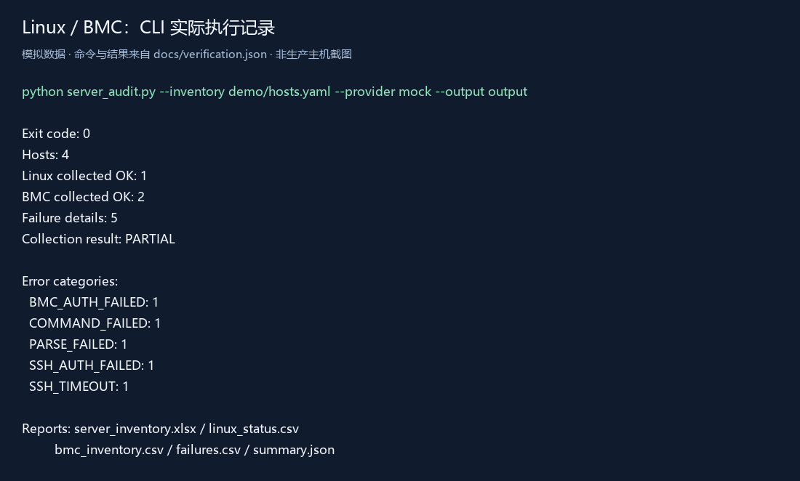
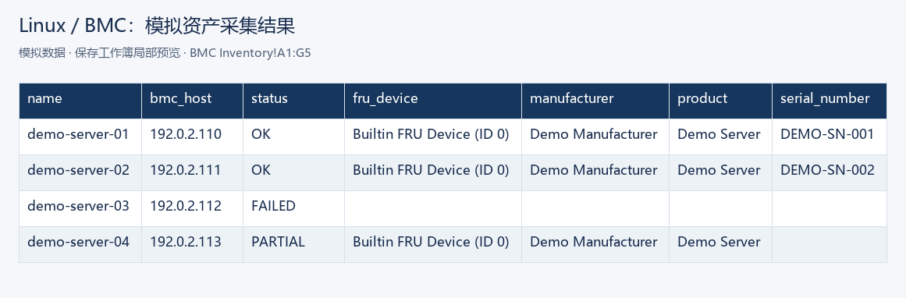
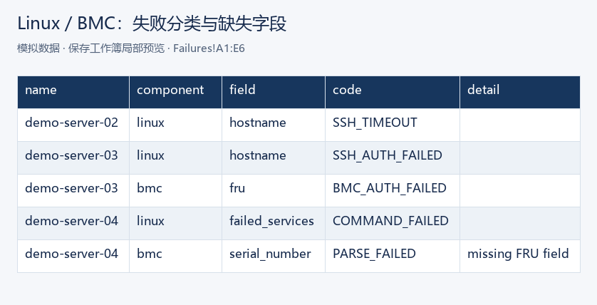

# Linux / BMC 服务器批量巡检工具

> **Demo notice:** The default provider uses mock responses and all included hosts and results are synthetic. No client data is included. The real SSH/BMC path has not been verified on live devices.

批量采集 Linux 主机和 BMC 基础信息，并统一输出巡检报告，适合服务器资产盘点、日常巡检和故障前置检查。公开演示版本使用模拟主机，不包含实际生产环境地址和资产信息。

此公开版本按实际工作中的 Linux 巡检、BMC/IPMI 信息采集和批量结果整理经验重构。它是可运行的通用样例，不代表已在某个客户生产环境部署或验证。

## 两分钟看效果

需要 Python 3.10+。在本目录运行：

```bash
pip install -r requirements.txt
python server_audit.py --inventory demo/hosts.yaml --provider mock --output output
pytest -q
```

默认使用 mock 数据，不需要 SSH、BMC 或 `ipmitool`。模拟清单有 4 台主机，展示正常采集、SSH 超时、认证失败、单字段失败和 BMC 字段缺失。命令结束后生成：

| 文件 | 用途 |
| --- | --- |
| `output/server_inventory.xlsx` | Summary、Linux Status、BMC Inventory、Failures 四张表 |
| `output/linux_status.csv` | Linux 基础系统状态与每台采集状态 |
| `output/bmc_inventory.csv` | FRU 厂商、产品、序列号与每台采集状态 |
| `output/failures.csv` | 主机、部分、字段和错误分类 |
| `output/summary.json` | 数量汇总，便于后续自动处理 |

`output-example/` 保存同一模拟清单的示例结果。`docs/screenshots/` 有命令执行、Excel 结果和失败分类展示图。





表格图来自保存工作簿的实际单元格，是局部渲染预览；CLI 图根据实际执行记录排版。公开版在 Windows / Python 3.12 的独立环境通过 12 项测试，记录见 [验证记录](docs/verification.json)，依赖版本见 [已验版本](docs/validated-dependencies.txt)。

`OK` 表示指定字段采集成功，不等于主机健康。`PARTIAL` 表示至少一个字段失败；字段为空时应查看 `Failures`。磁盘容量、失败服务等原始信息需要人工结合环境判断。FRU 报告列出所取设备块；多块时只选择 `Builtin FRU Device (ID 0)`，否则标记解析失败。FRU 序列号可能不同于机箱序列号，需现场确认。SSH 或 BMC 单部分失败后，另一部分和后续主机仍会继续采集。连接级 SSH 认证失败或超时每台只做一次尝试。错误代码包括 `SSH_AUTH_FAILED`、`SSH_TIMEOUT`、`BMC_AUTH_FAILED`、`BMC_TIMEOUT`、`COMMAND_FAILED` 和 `PARSE_FAILED`。

## 输入与只读范围

`demo/hosts.yaml` 是 YAML 清单；每项须有唯一 `name`，并提供 Linux `host` + `ssh_user`、`bmc_host` 中至少一组。演示地址使用 RFC 5737 文档示例网段 `192.0.2.0/24`。主机名、地址和用户字段会校验；不接受在清单里附加命令。Linux 采集使用代码内固定命令：`hostname`、`uptime -p`、`uname -r`、`cat /etc/os-release`、`lscpu`、`free -b`、`df -P`、`lsblk`、`ip`、`systemctl --failed`。BMC 仅执行 `ipmitool -I lanplus ... -E fru`。没有写入、重启、RAID、固件或用户配置操作。

## real 模式的边界

仅对自己有权限的主机使用 `--provider real`，先审查目标清单和网络访问范围。此模式需要本机安装 `ipmitool`（若采集 BMC）；SSH 依赖 Paramiko。成功连接的 Linux 主机会对 11 个固定字段分别建立短连接，批量性能尚未在真实网络验证。示例：

```bash
python server_audit.py --inventory my-authorized-hosts.yaml --provider real --known-hosts my-known-hosts --timeout 8 --output output
```

SSH 严格验证 `known_hosts`，未知或变化的主机密钥被拒绝；可省略 `--known-hosts` 使用系统默认主机密钥文件。优先从环境变量 `AUDIT_SSH_KEY_PATH` 加载 SSH 私钥路径，也可用 `AUDIT_SSH_PASSWORD`。不会主动搜索其他私钥或 SSH agent。BMC 的 `AUDIT_BMC_USERS` 是逗号分隔用户名；相应密码放在 `AUDIT_BMC_PASSWORD_1`、`AUDIT_BMC_PASSWORD_2` 等环境变量。仅当上一组凭证被明确判定为认证失败时尝试下一组。运行时只向 `ipmitool` 子进程提供当前密码的 `IPMI_PASSWORD` 环境变量，密码不放在命令参数、清单、输出或日志里。建议通过受控的临时会话注入环境变量，使用后清除；不要把密码写入 shell 历史、`.env`、脚本、截图或仓库。`real` 路径没有在实际生产主机/BMC 上验证，网络连通、系统命令差异、权限和 FRU 字段仍须在授权环境验收。

## 项目结构

`server_audit.py` 是入口；`src/audit.py` 实现校验、固定只读采集、错误隔离和报告；`demo/` 放模拟清单与响应；`tests/` 验证成功、失败隔离、凭证重试和输出安全；`docs/case-summary.md` 可作为案例描述；`output-example/` 是模拟报告。CSV/Excel 的文本字段会处理公式前缀，避免打开报告时把采集内容当公式执行。
